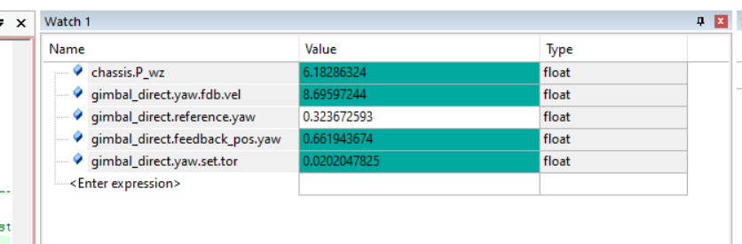

# 小陀螺开启时枪管世界角偏移检查（2026-11-22）

> 最新现场结果：用户已自行把手动 yaw 前馈从 2.0 调为 1.45 并提供实车 Watch 图，本机参数也已为 1.45。新图世界角差约 0.284°，此前 2.0 的图约 19.86°；两次底盘估计速度均约 6.15 rad/s。以下保留旧配置推导和调试过程，最新数据见“1.45 实车对照”一节。Codex 本轮未改该参数。


适用 `StandardRobotpp master@0f32f1a` 上本地未提交工作区，沿用前一轮 N/S 无目标回正修改。本轮用户补充：小陀螺从上往下看逆时针，枪管相对地面左偏后停在该角度。仍按此前确认的 N 档手动路径分析；S 档有效自瞄使用另一套控制器，不能套用下式。未独立核实板上固件身份。

## 2.0 配置的代码机制（历史）

N 档的云台手动世界角参考只受摇杆增量影响；扳机只选择底盘旋转状态，不会主动给 `reference.yaw` 加一个固定左偏角。`CHASSIS_SPIN_LEAD_TIME` 也只用于平移坐标前瞻，不修改枪管世界角目标。实物摇杆是否完全落在死区，仍须观察实际参考角。

手动 yaw 的世界角来自 IMU，速度内环读 DM 编码器关节速度。当前方向宏为 +1，各级不饱和时，实际源码公式为：

```text
e = wrap(reference.yaw - feedback_pos.yaw)
w = feedback_vel.yaw                       # IMU 角速度
P = chassis.P_wz                            # 四轮速度推算值
v = yaw.fdb.vel                             # DM 关节速度
v_set = 10*e - 0.25*w + 2*P
tau_cmd = 1.25*(v_set - v)
        = 12.5*e - 0.3125*w + 2.5*P - 1.25*v
```

实际还有角度环输出 ±20 rad/s、叠加后速度设定 ±20 rad/s、力矩 ±7 N·m 限幅。DM 发送函数使用 MIT 纯力矩，位置、速度、Kp、Kd 字段为零；`yaw.set.vel` 是 C 板内部速度参考，不会再由电机执行一个额外的速度环。两级 PID 的 Ki 均为 0。

枪管相对地面停住时，IMU 角速度应接近零，但底盘还在转，因此 DM 的相对关节速度一般不为零。稳态驱动力矩由减速器、轴承、线束等实际负载决定。纯 P 串级中，`2*P`、DM 关节速度及维持旋转所需力矩若未匹配，就会由固定角误差项提供差额。因此“偏一个角度后保持、底盘停下又回来”与速度/负载偏置造成的静差相容；不能仅凭相容就认定实车原因已唯一确定。

在小姿态、同一正方向和正确速度标定的条件下，关节速度与云台/底盘世界角速度存在运动学差值关系。但本机 `P_wz` 的正号不能仅凭变量名直接等同于 IMU 世界 yaw 正号；用户确认的物理逆时针也不能单独给出 DM 原始编码器的符号。因而本轮不直接把补偿系数从 2 改成 1 或 -1。

## 实际 C/PID 平衡点复核

扩展 `tests/diagnose_yaw_chassis_coupling.py`，实际执行云台参考和控制函数及 `pid.c`。设世界参考 0、世界角速度 0，并人为指定 `r=v/P`；在零维持力矩、无饱和的构造工况下：

```text
feedback_pos.yaw - reference.yaw = (2-r)*P/10
```

| 人为指定条件 | 实际源码结果 |
|---|---|
| r=1，P=+2.617994 rad/s | 世界角偏差 +15°、力矩约 0 |
| r=1，P=-2.617994 rad/s | 世界角偏差 -15°、力矩约 0 |
| r=1.5，P=+2.617994 rad/s | 世界角偏差 +7.5°、力矩约 0 |
| r=2，P=+2.617994 rad/s | 世界角偏差 0°、力矩约 0 |
| r=-1，P=+2.617994 rad/s | 世界角偏差 +45°、力矩约 0 |

这些比例、转速和零维持力矩都是人为构造，不是测量、拟合、真实负载模型或旋转稳定性证明；表内正负号属于代码角度坐标，未标定为实车左/右。实际参考角在上述按住扳机的构造中保持不变。既有回正和 S 有目标→BODY 的实际代码检查也仍通过。

15° 对当前角度环等效为约 2.617994 rad/s 的速度修正，在无饱和的速度 P 环等效为 3.272492 N·m 的力矩项。这些是角差在控制公式中的量级，不是实际输出力矩或底盘实测速度。

## 已核查的其他变量

- 轮速输入由 DJI RPM 乘 `RPM_TO_OMEGA` 转为电机 rad/s，`P_wz` 再按轮半径、中心距与外部减速比 268/17 解算；未发现这里直接混用度和弧度。轮胎滑移、轮径和几何误差仍会影响实际比例。
- DM 速度由 12 位量按 ±30 rad/s 映射后原样送入速度环；没有再次乘减速比 10。源码旧注释中的 ±45/±18 与实际宏不一致，不能用注释判断当前解码范围。映射范围必须与驱动器实际设置一致，本轮未读回驱动器参数。
- 本机 V1.1 原厂说明书第 5、7 页确认 MIT 纯力矩模式及映射范围可由调试助手配置；已提取相关完整页并渲染查看第 7 页。物理空载速度约 200 rpm（约 20.94 rad/s）或软件 ±20 限幅，并不能推出协议 V_MAX 必须为 20；不能据此把 ±30 解码直接判错。[原厂手册在线副本](https://damiao.enactic.ai/assets/files/dm-j4310-2ec-v1.1-zh-5d089e0b013d8e2fc203c5b670008a66.pdf)
- 仅按已配置 yaw gyro bias=0.001946855 rad/s 计算，0.25 倍 IMU 阻尼对应角差约 0.00279°；按 ±30/12 位的半个速度量化步长计算，对应角差约 0.04197°。这些已知量级无法单独解释 15°，但不排除未测到的传感器偏差或比例错误。
- IMU yaw 漂移通常需要结合角度、速度与时间核验，不能仅凭“偏后停稳”彻底排除；当前反馈也不足以区分速度补偿比例错误和实际机械负载。

## 用户 Watch 读数：偏角正在抵消过大的速度前馈

用户提供截图并说明数值在该附近变化；图中五项为：

| 变量 | 截图值 |
|---|---:|
| chassis.P_wz | +6.18286324 rad/s |
| yaw.fdb.vel | +8.69597244 rad/s |
| reference.yaw | 0.323672593 rad |
| feedback_pos.yaw | 0.661943674 rad |
| yaw.set.tor | +0.0202047825 N·m |



按当前本机 N 档参数展开：

```text
世界角反馈 - 目标 = 0.338271081 rad = 19.381505°
位置环速度修正 = 10*(目标 - 反馈) = -3.38271081 rad/s
底盘速度前馈 = 2*P_wz = +12.36572648 rad/s
二者相加（暂不计 IMU 阻尼） = +8.98301567 rad/s
DM 关节速度反馈 = +8.69597244 rad/s
```

这组读数明显支持速度前馈偏大、位置环靠固定角差抵消的机制：前馈与 DM 反馈差额约 3.669754 rad/s，其中约 92.18% 由位置环的负向修正抵消。相对于截图中的世界角目标，实际偏差约 19.4°，比用户最初目测约 15° 稍大。按该工况描述，其物理表现为左偏；这不是位置参考里写入了一个左偏量。

补偿项和 DM 关节速度在图中同为正，当前证据更支持倍率/反馈尺度匹配问题，不能据此把补偿翻成负号。DM/P 的单点比值约 1.40646；若 IMU 世界角速度接近零、维持力矩也较小，零位置误差对应的局部补偿系数约为 `(v_DM+tau_cmd/1.25)/P=1.40908`。这只是当前工况的条件估算，不是全转速、全姿态的标定，不等于已授权或已验证把参数改成 1.4。

五个 Watch 数值还不能严丝合缝地作为同拍稳态样本：若 IMU 速度为零，当前源码算出的力矩约为 0.358804 N·m，并非图中的 0.020205 N·m；若其他值完全同拍且参数相同，所需 IMU 速度约为 +1.083518 rad/s。这个速度是代数反算量，不是测量结果，不能据此声称枪管实际以约 62°/s 转动。用户说读数在附近变化，Watch 各项不同步、实际小幅动态、IMU 阻尼或板上参数不同均可能参与差额。

扩展实际 C/PID 诊断：把截图五项和人为 IMU=0 输入实际云台代码，得到力矩 0.358803 N·m；再输入反算的 IMU=1.083515，得到约 0.020206 N·m，复核通过。这证明公式与本机实现一致，不证明缺失 IMU 速度已经测得，也不验证板上固件身份。已请求用户补充同工况的 `gimbal_direct.feedback_vel.yaw`。

具体物理原因仍需区分：补偿参数本身偏大、DM 速度映射范围不匹配、底盘轮速估计尺度/滑移，以及当前 IMU 速度不为零。单点 DM/P≈1.406 也不能直接证明驱动器 V_MAX 应为 20。未改生产参数，保留当前补偿 2.0。

## 第二次 Watch：已补充 IMU 速度，倍率候选收敛至约 1.45

用户随后提供含六项变量的新照片；此图与前图的目标角不同，不能拼作同一连续轨迹或用两图求导。按照片辨读：

| 变量 | 数值 |
|---|---:|
| P_wz | +6.14818573 rad/s |
| DM 关节速度 | +8.63736243 rad/s |
| 世界角目标 | 0.801405847 rad |
| 世界角反馈 | 1.14804602 rad |
| 命令力矩 | +0.825154781 N·m |
| IMU 速度 | -0.0330231972 rad/s |

原图保存在本机被忽略的验证目录 `MDK-ARM/vt13-control-verification/yaw-spin-bias/watch-with-imu.png`，避免把大幅屏摄照片加入源码差异。

角偏差约为 0.346640173 rad，即 19.861019°。实际 IMU 速度约 -1.89°/s，不能称严格零速，但它的阻尼修正仅 +0.0082558 rad/s，等效位置角差约 0.0473°，远小于约 20° 的偏角。因此该 IMU 阻尼项不是大偏角的主要来源。

当前速度项为 `12.29637146 - 3.46640173 + 0.00825580 = 8.83822553 rad/s`，DM 反馈约 8.63736243。DM/P≈1.404864，与第一张图的 1.406464 接近；两图共同支持当前 2.0 前馈与实际反馈尺度/所需维持量不匹配。

若保持工况的其余量不变，仅把现有位置误差折算回前馈，候选公式为 `c_new=2-10*(world-reference)/P`。第一图给 1.452889，第二图给 1.436191，可提出 **1.45 作为下一步单参数对照候选**。它是当前位置误差的局部等效量，尚非全工况标定，不保证更换后偏差严格为零，也不能据此排除 DM 映射或轮速尺度问题。此前约 1.4 的说法是忽略负载/细节的粗估，现优先采用约 1.45 的对照候选。

六项仍不能当成严格同拍、同参数的闭环验收：本机实际 C/PID 算得命令力矩约 0.251079 N·m，与照片读作 0.825154781 不完全相等。不能继续把差额解释为缺失的 IMU 速度，因为该项现在已测得；Watch 非同步刷新、实际动态、照片辨读或板上参数版本仍需保留。实际 C/PID 新增六项复核通过，验证的是本机公式预测值，不是预测值等于实测力矩。

本轮未再索要连续曲线，也未修改补偿系数或其他生产代码；若进行下一步对照，应仅改手动 yaw 的 `GIMBAL_DIRECT_YAW_WZ_FEEDFORWARD`（2.0→1.45 候选），保持自瞄独立控制器和此前回正逻辑不动，并以新的实车结果判断。

## 1.45 实车对照：截图角差约 0.284°

用户明确说明新图是 1.45 的效果。本机 `GIMBAL_DIRECT_YAW_WZ_FEEDFORWARD` 也已从 2.0 改为 1.45，属于用户现场修改；另新增的 `Src/main.c` 差异只有 HAL_Init 前缩进，Codex 未清理或覆盖。完整板上固件身份未独立读回，按用户确认的参数对照记录。

| 变量 | 1.45 新图 |
|---|---:|
| P_wz | +6.15404081 rad/s |
| DM 关节速度 | +8.41758347 rad/s |
| 世界角目标 | 0.00313734333 rad |
| 世界角反馈 | 0.00809197966 rad |
| 命令力矩 | +0.525876284 N·m |
| IMU 速度 | +0.0319579318 rad/s |

世界角差为 `0.00809197966-0.00313734333=0.00495463633 rad≈0.283880°`。与前一张 2.0 图约 19.861° 相比，两个截图点的绝对角差下降约 98.57%；这不是一段时序的 RMS 或长期稳定性指标。P_wz 从约 6.14819 到 6.15404，仅相差约 0.095%，说明角差减少并非靠显著降低底盘旋转速度获得。

本次对照强烈支持该工况的大静差主要来自原 2.0 速度前馈偏大。实际 C/PID 按当前 1.45 和新图输入算得力矩约 0.560300 N·m，图中为 0.525876，差约 0.034424；比旧图更接近，但仍不将 Watch 刷新视为严格同拍。原图存于被忽略的验证目录 `MDK-ARM/vt13-control-verification/yaw-spin-bias/watch-ff145.png`。

诊断脚本现分开编译当前参数和只在临时桥接中覆盖为 2.0 的历史配置，分别复核各自截图，避免把历史 2.0 的力矩断言套到当前 1.45。两套实际 C/PID 诊断均通过；当前 1.45 的 31 项 VT13 主机回归也通过。本轮未由 Codex 重新运行 Keil、烧录或提交/推送。收尾时还观察到用户将yaw中值改为-0.540360451（无f后缀），已保留；按最终磁盘参数重新执行31项VT13回归和分版本实际C/PID诊断，均通过。该中值影响初始化及跟随零点，不直接进入N档世界角/速度补偿公式，不与前馈一并视作完成标定。

建议先保留用户当前 1.45，不为这一张图剩余约 0.28°继续微调。后续观察启停及其他转速/平移工况，再决定是否需要进一步标定；尚未证明所有姿态、所有转速、反向旋转或长期保持均通过。DM/轮速尺度也未被独立标定，但不影响本次参数对照明显改善的结论。

## 实车定因所需的最小读数

不需要连续曲线。维持“小陀螺仍旋转，枪管已左偏并停稳”，读取同一时刻的 `chassis.P_wz`、`gimbal_direct.yaw.fdb.vel`、`gimbal_direct.reference.yaw`、`gimbal_direct.feedback_pos.yaw`、`gimbal_direct.yaw.set.tor`；若 IMU 速度并不接近零，还需补该值。先检查参考是否改变、实际关节速度与 P 的符号/比例、速度或力矩是否饱和，再决定是否修改 2.0 补偿系数。

后续已收到第二张含 IMU 的 2.0 图，以及用户自行调至 1.45 的实车对照图。当前 1.45 在该工况明显改善，不再只是未测试候选；完整参数标定与其他工况仍待验证。

本轮只扩展诊断脚本并记录证据，没有修改生产控制或参数，没有重新进行 Keil 构建、烧录、提交或推送。前一轮回正修正及其验证保持独立，不视为本次枪管左偏已修复。
